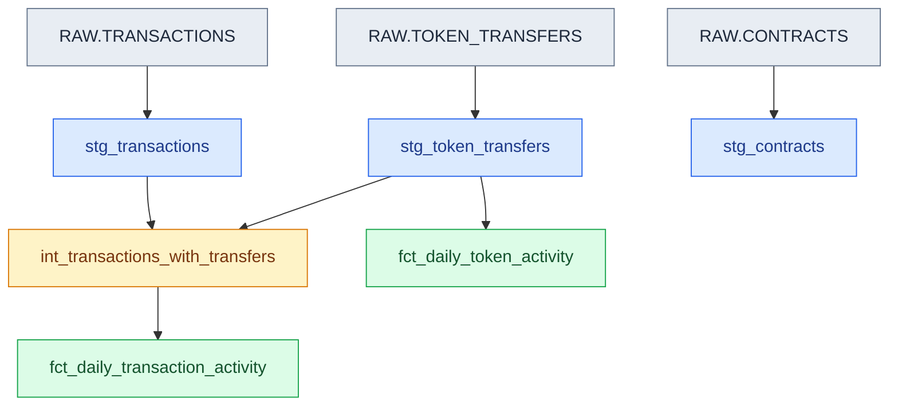

# Ethereum Analytics Pipeline — dbt + Snowflake

**Status:** Milestones 1–9 implemented: Snowflake ingestion across three historical partitions, six dbt models, automated data and unit testing, a reusable date macro, and an incremental daily token activity mart. Milestone 9 verified newly arriving data insertion without a full refresh, reconciliation across all three dates, and stable aggregate totals on a subsequent incremental run. The latest test suite passed (34 data tests and 1 unit test; 35/35). The last complete integrated `dbt build` passed in Milestone 7 (41/41 operations).

## Project Overview

An end-to-end analytics engineering portfolio project that transforms public Ethereum blockchain data into validated, analysis-ready datasets using **Snowflake, SQL, and dbt Core**.

The pipeline ingests Parquet data from Amazon S3 into Snowflake, applies layered transformations through dbt, and produces daily transaction and token-transfer activity marts.

**Key engineering features:**

- **ELT architecture:** Snowflake external stages, RAW `VARIANT` storage, and dbt staging, intermediate, and mart layers.
- **Data modeling:** Transaction-level enrichment with pre-aggregated token transfers to prevent join fanout.
- **Incremental processing:** Snowflake `MERGE` with a composite date/token key and a one-day lookback window.
- **Data quality:** 34 automated data tests and one unit test, all passing.
- **Validated ingestion:** Three historical partitions containing 3,000 sampled transactions and 5,508 token-transfer events.
- **Reproducibility:** Version-controlled SQL scripts, documented validation procedures, and Git-based development.

**Current scope:** A working development pipeline using a deliberately limited, non-representative Ethereum sample. The objective is to demonstrate analytics engineering practices rather than estimate network-wide blockchain activity.

## Technology Stack

| Technology | Purpose |
|---|---|
| Snowflake | Ingestion, storage, views, tables, and SQL execution |
| dbt Core 1.12.6 + dbt-snowflake 1.12.4 | SQL transformations, tests, and project configuration |
| dbt_utils 1.4.1 | Composite-key uniqueness testing |
| AWS Public Blockchain Data | Public Ethereum Parquet datasets in Amazon S3 |
| Python 3.12 | Local virtual environment for dbt |
| Git / GitHub | Version control and documentation |
## Architecture

The project follows an **ELT (Extract, Load, Transform)** architecture. Public Ethereum Parquet data is accessed through Snowflake external stages and loaded into RAW tables using `VARIANT` columns. dbt transforms the data into typed staging views, an intermediate transaction-enrichment view, and two analytics marts.

**Execution environments:**

- **Snowflake:** Stores RAW and transformed data, executes SQL transformations and tests, and performs incremental `MERGE` operations.
- **dbt Core (local environment):** Compiles SQL and Jinja, manages model dependencies, and submits transformations and tests to Snowflake.

### dbt Model Lineage

The following diagram shows the dependencies between the six dbt models and their Snowflake RAW sources. Downstream models reference upstream models using dbt `ref()`.



The architecture separates ingestion, standardization, enrichment, and analytical aggregation:

- **RAW layer:** Preserves source records in Snowflake `VARIANT` columns.
- **Staging layer:** Three views extract and standardize typed fields from RAW records.
- **Intermediate layer:** `int_transactions_with_transfers` aggregates transfer events before joining them to transactions, preventing one-to-many join fanout.
- **Analytics marts:** `fct_daily_transaction_activity` is materialized as a table at daily grain, while `fct_daily_token_activity` uses incremental `MERGE` processing at the date/token grain.

The `stg_contracts` model is currently independent of both marts. The token activity mart reads directly from `stg_token_transfers`, while the transaction activity mart depends on `int_transactions_with_transfers`.

### Snowflake Resources

| Resource | Name / configuration |
|---|---|
| Database | `ETHEREUM_PORTFOLIO` |
| RAW schema | `RAW` |
| Analytics schema | `ANALYTICS` |
| Warehouse | `DBT_WH` |
| Warehouse size | XSMALL |
| Auto-suspend | 60 seconds |
| Auto-resume | Enabled |

The small development warehouse helps limit unnecessary compute usage.

## Data Sources

Source: [AWS Public Blockchain Data](https://registry.opendata.aws/aws-public-blockchain/).

| Dataset | Description |
|---|---|
| Transactions | Transaction hashes, addresses, timestamps, value, gas, and execution metadata |
| Token transfers | Token-transfer events associated with Ethereum transactions |
| Contracts | Contract addresses, bytecode, and block metadata |

The development sample contains transaction and token-transfer records from three historical partitions: **2024-01-15, 2024-01-16, and 2024-01-17**. Each partition contributes 1,000 sampled transactions and their associated token-transfer events, giving a total of **3,000 transactions and 5,508 transfer events**. Contract records are sampled independently from January 15 only (1,000 records). Snowflake external stages read public S3 Parquet files; the repository does not distribute those source files.

## RAW Data Ingestion

### External Stages

- `ETH_TRANSACTIONS_STAGE`

- `ETH_TOKEN_TRANSFERS_STAGE`

- `ETH_CONTRACTS_STAGE`

Each RAW table has one `RAW_RECORD VARIANT` column. This preserves source fields and separates ingestion from type casting and normalization in dbt.

### Development Sampling Strategy

**Transactions and token transfers:**

1. Select 1,000 distinct transaction hashes from token-transfer events, ordered by hash.

2. Load the corresponding transactions from the same historical partition.

3. Load every token-transfer event associated with those transactions.

This relationship-aware approach provides transaction-to-transfer matches for downstream modeling. An earlier independent transaction sample produced no matching token transfers, so the ingestion strategy was revised.

**Contracts:** Select 1,000 records independently, ordered by contract address. These records are **not guaranteed to correspond** to token contracts in the sampled transfers.

**Repeatability:** The ingestion script truncates the three RAW tables before reloading them, avoiding accumulation across runs. Sample selection is reproducible provided the underlying source files remain unchanged.

## RAW Data Validation

The table below documents validation of the original January 15 sample. Subsequent incremental ingestion extended the transaction and token-transfer datasets through January 17, 2024. The current RAW totals are **3,000 transactions** and **5,508 token-transfer events** across three dates. The independently sampled contracts remain at **1,000 records**.

The January 16 and January 17 partitions were appended using Snowflake `MERGE` operations, preserving existing records. Daily transaction and transfer counts are documented in Milestones 8 and 9.

| Validation | Result |
|---|---:|
| Transactions loaded | 1,000 |
| Missing transaction hashes | 0 |
| Duplicate transaction hashes | 0 |
| Token-transfer events loaded | 1,779 |
| Missing transfer transaction hashes | 0 |
| Missing transfer log indexes | 0 |
| Non-unique or missing transfer event keys | 0 |
| Token transfers without a matching transaction | 0 |
| Distinct transactions represented in transfers | 1,000 |
| Contract records loaded | 1,000 |
| Missing contract addresses | 0 |
| Repeated contract addresses | 1 |

Every sampled transaction has at least one associated token-transfer event.

### Known Data Quality Finding: Repeated Contract Address

Address `0x00ddede78cdb1c76d33c8029799aa60d5e566b38` occurs in two records with different block numbers, block hashes, block timestamps, and last-modified values. Both have `0x` bytecode; the investigation did not establish the cause of repetition.

Both records are **retained in RAW and staging**. The staging model therefore does not guarantee uniqueness of `contract_address`. Any downstream one-row-per-address model must explicitly define and document a selection rule rather than silently discarding a record.

## dbt Staging Layer — Complete

The staging layer extracts typed columns from RAW `VARIANT` records using `source()` references declared in `models/staging/_sources.yml`.

| Model | Materialization | Grain / key | Validated rows |
|---|---|---|---:|
| `stg_transactions` | View | One row per `transaction_hash` | 3,000 |
| `stg_token_transfers` | View | One row per (`transaction_hash`, `log_index`) | 5,508 |
| `stg_contracts` | View | One row per source contract record; addresses may repeat | 1,000 |

`stg_transactions` standardizes transaction hashes, block metadata, addresses, value in wei, gas fields, and receipt metadata. `stg_token_transfers` retains token amounts in their raw smallest-unit representation because token decimal precision has not been established. `stg_contracts` standardizes contract metadata and bytecode without deduplicating addresses.

### Automated Tests

| Model | Automated checks | Passing tests |
|---|---|---:|
| `stg_transactions` | Non-null transaction hash; unique transaction hash; non-null block timestamp | 3 |
| `stg_token_transfers` | Non-null transaction hash, log index, and block timestamp; `dbt_utils` composite-key uniqueness; relationship to `stg_transactions` | 5 |
| `stg_contracts` | Non-null contract address, block number, and block timestamp | 3 |
| **Total** | | **11** |

The contracts model intentionally has **no unique-address test**, reflecting the documented source anomaly. Manual Snowflake SQL checks additionally verified record counts and the single repeated address.

**Earlier staging milestone:** `dbt build --select staging` completed with 3 views and 10 tests (13/13 operations), before the relationship test was introduced. The latest integrated build includes all 11 staging tests.

## dbt Intermediate Layer — First Model Complete

### Transaction Enrichment

| Property | Value |
|---|---|
| Model | `int_transactions_with_transfers` |
| Materialization | View |
| Snowflake location | `ETHEREUM_PORTFOLIO.ANALYTICS` |
| Grain | One row per `transaction_hash` |

This model enriches standardized Ethereum transactions with aggregated token-transfer metrics. It references `stg_transactions` and `stg_token_transfers` through dbt `ref()` dependencies.

Token transfers are aggregated by `transaction_hash` **before** joining them to transactions. This avoids one-to-many join fanout, which could otherwise duplicate transaction rows and inflate transaction-level measures such as gas usage. A `LEFT JOIN` retains transactions without matching transfers; `COALESCE` gives those transactions zero transfer counts.

| Derived column | Meaning |
|---|---|
| `transfer_count` | Number of token-transfer events associated with the transaction |
| `distinct_token_count` | Number of distinct token addresses in those events |
| `has_token_transfer` | Whether the transaction has at least one associated transfer |

### Intermediate Model Validation

The model was manually validated against the development sample from **2024-01-15** using `snowflake_setup/12_validate_int_transactions_with_transfers.sql`.

| Validation | Result |
|---|---:|
| Intermediate transaction rows | 1,000 |
| Distinct transaction hashes | 1,000 |
| NULL transaction hashes | 0 |
| Total aggregated transfer events | 1,779 |
| Transactions with transfers | 1,000 |
| Transactions without transfers | 0 |
| Minimum transfers per transaction | 1 |
| Maximum transfers per transaction | 52 |

The results confirm the expected transaction grain and reconcile the aggregate number of transfers with the staging sample. The source sampling strategy deliberately includes only transactions with transfer events; therefore, the `LEFT JOIN` behavior for transactions without transfers is not exercised by this sample. A controlled dbt unit test now covers this case.

### Intermediate Model Automated Tests

Five generic tests in `models/intermediate/_int_transactions_with_transfers.yml` check the non-null transaction hash, unique transaction hash, and non-null `transfer_count`, `distinct_token_count`, and `has_token_transfer` values.

Two singular SQL tests provide additional validation:

- `tests/assert_transaction_transfer_metrics.sql` checks logical consistency between transfer counts, distinct token counts, and the transfer indicator.

- `tests/assert_transaction_transfer_reconciliation.sql` independently aggregates staging transfers and compares the resulting metrics against each intermediate transaction.

All **seven intermediate-model tests passed**. The integrated dependency build also passed:

```bash
dbt build --select +int_transactions_with_transfers
```

**Result:** 3 views built, 14 tests passed, 0 execution errors (**17/17 operations**). This selection includes `stg_transactions` and `stg_token_transfers`, but not `stg_contracts`, which is not an upstream dependency.

## dbt Analytics Marts — Two Models Complete

### Daily Transaction Activity

| Property | Value |
|---|---|
| Model | `fct_daily_transaction_activity` |
| Materialization | Table |
| Snowflake location | `ETHEREUM_PORTFOLIO.ANALYTICS` |
| Grain | One row per `activity_date` |
| Upstream model | `int_transactions_with_transfers` |

The mart aggregates sampled transactions into daily activity metrics suitable for downstream reporting. It uses the intermediate model's transaction-level grain, avoiding join fanout when calculating gas and transaction measures.

| Column | Definition |
|---|---|
| `activity_date` | Calendar date derived from `block_timestamp` |
| `transaction_count` | Number of sampled transactions |
| `token_transfer_count` | Sum of transaction-level token-transfer events |
| `transactions_with_transfers` | Number of transactions with at least one transfer |
| `avg_transfers_per_transaction` | Average transfer events per transaction |
| `total_gas_used` | Sum of gas used |
| `avg_gas_used` | Average gas used per transaction |

A daily distinct-token count is intentionally not calculated by summing transaction-level distinct counts, since the same token can appear in multiple transactions.

### Mart Validation

Manual validation is preserved in `snowflake_setup/13_validate_fct_daily_transaction_activity.sql`. The original one-day sample produced:

| Metric | Validated result |
|---|---:|
| Activity date | 2024-01-15 |
| Daily rows / distinct dates | 1 / 1 |
| Transactions | 1,000 |
| Token-transfer events | 1,779 |
| Transactions with transfers | 1,000 |
| Average transfers per transaction | 1.779 |
| Total gas used | 111,184,480 |
| Average gas used | 111,184.48 |
| NULL activity dates | 0 |
| NULL transaction counts | 0 |

The mart's transaction count, transfer count, transactions-with-transfers count, and total gas used **reconciled exactly** with independently aggregated intermediate-model totals.

### Mart Automated Tests

Six generic tests in `models/marts/_fct_daily_transaction_activity.yml` verify non-null `activity_date`, unique `activity_date`, and non-null values for `transaction_count`, `token_transfer_count`, `transactions_with_transfers`, and `avg_transfers_per_transaction`.

The singular test `tests/assert_daily_transaction_activity_reconciliation.sql` independently recalculates daily metrics from the intermediate model, compares them date by date, and checks for missing dates or metric discrepancies, including average-value differences within a defined tolerance.

**Result:** All **7 mart tests passed** (6 generic and 1 reconciliation). Gas fields are not currently subject to generic non-null tests.

### Daily Token Activity

| Property | Value |
|---|---|
| Model | `fct_daily_token_activity` |
| Materialization | Incremental (`merge`) |
| Snowflake location | `ETHEREUM_PORTFOLIO.ANALYTICS` |
| Grain | One row per (`activity_date`, `token_address`) |
| Upstream model | `stg_token_transfers` |

The mart aggregates sampled token-transfer events by date and token contract address. It counts distinct transactions, sending addresses, and receiving addresses within each date/token group. Counts of distinct addresses are **not** counts of distinct people.

| Column | Definition |
|---|---|
| `activity_date` | Calendar date derived from `block_timestamp` |
| `token_address` | Token contract address |
| `transfer_count` | Number of transfer events |
| `transaction_count` | Distinct transactions involving the token |
| `unique_senders` | Distinct sending addresses |
| `unique_receivers` | Distinct receiving addresses |

Token quantities are deliberately excluded: raw token values cannot be compared meaningfully without token-specific decimal precision and appropriate normalization.

#### Token Mart Validation

Manual validation is preserved in `snowflake_setup/14_validate_fct_daily_token_activity.sql`. For the original 2024-01-15 development sample:

| Validation | Result |
|---|---:|
| Mart rows | 352 |
| Distinct date/token combinations | 352 |
| NULL dates | 0 |
| NULL token addresses | 0 |
| Staging transfer events | 1,779 |
| Mart transfer events (sum of `transfer_count`) | 1,779 |

The most active sampled token address, `0xc02aaa39b223fe8d0a0e5c4f27ead9083c756cc2`, has 324 transfer events across 278 transactions. Another token has 52 transfer events within a single transaction, illustrating why event and distinct-transaction counts are separate metrics.

#### Token Mart Automated Tests

Six generic non-null checks and one `dbt_utils.unique_combination_of_columns` test (date and token address) are declared in `models/marts/_fct_daily_token_activity.yml`. The singular test `tests/assert_daily_token_activity_reconciliation.sql` independently aggregates staging data, compares all four metrics for every date/token combination, and detects missing or unexpected groups. A second singular test, `tests/assert_daily_token_activity_metrics.sql`, verifies positive counts and that distinct transaction, sender, and receiver counts do not exceed the transfer-event count.

**Result:** All **9 token mart tests passed** (7 generic and 2 singular). The generic test uses dbt's `arguments:` configuration for compatibility with dbt 1.12.

### Full Integrated Build

```bash
dbt build
```

**Last complete integrated build (Milestone 7):** **PASS=41, WARN=0, ERROR=0** — 4 views, 2 tables, 34 data tests, and 1 unit test. The integrated build validates the complete dependency graph, including the independent contracts staging model.

The earlier full-build failure was caused by a manual, multi-statement Snowflake ingestion worksheet located inside dbt's `tests/` directory. Moving it to `snowflake_setup/test_s3_ingestion.sql` keeps the script for reference without causing dbt to parse it as a singular data test.

## Milestone 6 — Expanded Data Quality and Unit Testing

Three additional checks strengthen coverage beyond basic non-null, uniqueness, and source reconciliation tests:

| Check | Location | What it verifies |
|---|---|---|
| Referential integrity | `models/staging/_stg_token_transfers.yml` | Each non-null transfer `transaction_hash` exists in `stg_transactions` (`relationships` generic test) |
| Token activity business rules | `tests/assert_daily_token_activity_metrics.sql` | Transfer, transaction, sender, and receiver counts are positive; distinct counts do not exceed transfer events |
| Transaction enrichment unit test | `models/intermediate/_int_transactions_with_transfers_unit.yml` | Correct aggregation for repeated tokens, a single transfer, and a transaction with no transfers |

The unit test `test_transaction_enrichment_scenarios` supplies three mock transactions and four mock transfer events. It checks that a transaction with three events involving two tokens yields `transfer_count=3` and `distinct_token_count=2`; a transaction with no events is retained with zero counts and `has_token_transfer=false`; and a single-transfer transaction has counts of one. Unlike the real sample, these controlled inputs explicitly exercise the zero-transfer `LEFT JOIN` behavior.

Run the unit test independently with:

```powershell
dbt test --select test_transaction_enrichment_scenarios
```

**Validated Milestone 6 result:** 6 models, **34 data tests**, **1 unit test**, and **41/41 successful build operations**. The local `DBT_ENGINE_MANAGE_STATE` reserved-prefix deprecation warning remains non-blocking.

## Milestone 7 — Reusable Date Conversion Macro

The `macros/to_activity_date.sql` macro centralizes conversion of an Ethereum block timestamp expression into a calendar date:

```sql

CAST({{ timestamp_expression }} AS DATE)

```

Both `fct_daily_transaction_activity` and `fct_daily_token_activity` invoke `{{ to_activity_date('block_timestamp') }}` to derive `activity_date`. The transaction activity mart also invokes it in its `GROUP BY` clause. This removes duplicated conversion logic while preserving each mart's established grain and metrics.

**Execution boundary:** dbt Core renders the Jinja macro locally during compilation; the generated `CAST(block_timestamp AS DATE)` SQL executes in Snowflake. The macro does not query Snowflake independently. The Jinja whitespace-control delimiters keep the compiled SQL readable.

**Validation:** After refactoring, `dbt build --select fct_daily_transaction_activity` passed all 8 operations (1 table and 7 tests), and `dbt build --select fct_daily_token_activity` passed all 10 operations (1 table and 9 tests). The subsequent full `dbt build` completed with **PASS=41, WARN=0, ERROR=0** (6 models, 34 data tests, and 1 unit test). No new tests were required for the behavior-preserving macro refactor.

## Milestone 8 — Incremental Processing and Two-Day Validation

The development sample was extended with January 16, 2024 data using `snowflake_setup/15_load_incremental_sample.sql`. Insert-only Snowflake `MERGE` operations appended **1,000 transactions** and **1,793 token-transfer events** while retaining the January 15 sample. Repeating both ingestion operations inserted **0 additional rows**.

The `fct_daily_token_activity` model is configured in `dbt_project.yml` with `materialized: incremental`, `incremental_strategy: merge`, and composite `unique_key: [activity_date, token_address]`. On incremental runs, `is_incremental()` applies a one-day lookback relative to the maximum date already present in the target table. Snowflake updates matching date/token groups and inserts new groups. This bounded lookback does not capture arbitrary older backfills or corrections.

**Verified two-day results:**

| Activity date | Token/date rows | Transfer events |
|---|---:|---:|
| 2024-01-15 | 352 | 1,779 |
| 2024-01-16 | 387 | 1,793 |
| **Total** | **739** | **3,572** |

A `dbt run --select fct_daily_token_activity --full-refresh` created the two-day baseline. A subsequent run **without** `--full-refresh` succeeded and preserved 739 rows and 3,572 transfer events. `snowflake_setup/16_validate_incremental_processing.sql` checks date coverage, composite-key uniqueness, reconciliation with staging, null keys, and aggregate totals. The regular table mart `fct_daily_transaction_activity` was also rebuilt to reflect both dates.

**Latest automated validation:** `dbt test` returned **PASS=35, WARN=0, ERROR=0** (34 data tests and one unit test). A new full integrated `dbt build` has not yet been recorded for Milestone 8.

**Scope of evidence:** Milestone 8 established the two-day baseline and verified that an incremental rerun preserved existing aggregate totals. Milestone 9 subsequently extended this validation by loading a new historical partition and confirming that dbt incorporated the additional date/token groups without a full refresh. See Milestone 9 for the three-day results and automated test outcomes.

## Milestone 9 — Three-Day Incremental Validation

Milestone 9 validates the insertion of newly arriving data into an existing dbt incremental model without performing a full refresh.

### New Historical Partition

`snowflake_setup/17_load_new_incremental_partition.sql` extends the development sample with January 17, 2024 data. Snowflake `MERGE` operations inserted **1,000 transactions** and **1,936 token-transfer events**, preserving the January 15–16 records.

After ingestion, the RAW tables contain **3,000 transactions** and **5,508 token-transfer events** across three historical dates.

### Incremental Processing

The existing `fct_daily_token_activity` mart contained 739 date/token rows before the January 17 ingestion.

Running `dbt run --select fct_daily_token_activity` without `--full-refresh` incorporated the newly arriving partition.

**Validated three-day results:**

| Activity date | Date/token rows | Transfer events |
|---|---:|---:|
| 2024-01-15 | 352 | 1,779 |
| 2024-01-16 | 387 | 1,793 |
| 2024-01-17 | 368 | 1,936 |
| **Total** | **1,107** | **5,508** |

### Validation and Repeatability

`snowflake_setup/18_validate_new_incremental_partition.sql` verifies:

- Daily coverage and transfer totals.
- Uniqueness of the composite `(activity_date, token_address)` merge key.
- Exact reconciliation between staging and mart transfer counts.
- Stable row and transfer totals following a subsequent incremental run.

All three dates reconciled exactly. Rerunning the incremental model without additional source data preserved **1,107 mart rows** and **5,508 transfer events**.

The regular `fct_daily_transaction_activity` table was also rebuilt, producing three daily rows.

**Automated validation:** `dbt test` completed successfully with **PASS=35, WARN=0, ERROR=0** (34 data tests and one unit test).

These results demonstrate incremental processing of a newly arriving historical partition and repeatable aggregate results. The model's one-day lookback remains a limitation for older backfills or corrections.

## Repository Structure

```text
ethereum-dbt-analytics/
├── snowflake_setup/
│   ├── 01_create_resources.sql
│   ├── 02_create_stages.sql
│   ├── 03_inspect_data.sql
│   ├── 04_load_raw_data.sql
│   ├── 05_validate_raw_data.sql
│   ├── 06_inspect_staging_source.sql
│   ├── 07_validate_stg_transactions.sql
│   ├── 08_inspect_token_transfers.sql
│   ├── 09_validate_stg_token_transfers.sql
│   ├── 10_investigate_contract_duplicates.sql
│   ├── 11_validate_stg_contracts.sql
│   ├── 12_validate_int_transactions_with_transfers.sql
│   ├── 13_validate_fct_daily_transaction_activity.sql
│   ├── 14_validate_fct_daily_token_activity.sql
│   ├── 15_load_incremental_sample.sql
│   ├── 16_validate_incremental_processing.sql
│   ├── 17_load_new_incremental_partition.sql
│   ├── 18_validate_new_incremental_partition.sql
│   └── test_s3_ingestion.sql
├── models/
│   ├── staging/
│   │   ├── _sources.yml
│   │   ├── stg_transactions.sql
│   │   ├── _stg_transactions.yml
│   │   ├── stg_token_transfers.sql
│   │   ├── _stg_token_transfers.yml
│   │   ├── stg_contracts.sql
│   │   └── _stg_contracts.yml
│   ├── intermediate/
│   │   ├── int_transactions_with_transfers.sql
│   │   ├── _int_transactions_with_transfers.yml
│   │   └── _int_transactions_with_transfers_unit.yml
│   └── marts/
│       ├── fct_daily_transaction_activity.sql
│       ├── _fct_daily_transaction_activity.yml
│       ├── fct_daily_token_activity.sql
│       └── _fct_daily_token_activity.yml
├── macros/
│   └── to_activity_date.sql
├── tests/
│   ├── assert_transaction_transfer_metrics.sql
│   ├── assert_transaction_transfer_reconciliation.sql
│   ├── assert_daily_transaction_activity_reconciliation.sql
│   ├── assert_daily_token_activity_reconciliation.sql
│   └── assert_daily_token_activity_metrics.sql
├── seeds/
├── analyses/
├── docs/
├── dbt_project.yml
├── packages.yml
├── package-lock.yml
├── requirements.txt
├── profiles.example.yml
└── README.md
```

The numbered `snowflake_setup/` scripts preserve the manual Snowflake development and validation workflow. The relocated `test_s3_ingestion.sql` is a manual Snowflake worksheet, **not** a dbt singular test. The dbt SQL and YAML files are the version-controlled source for transformation and automated testing.

## Getting Started

### 1. Snowflake Environment

Create a Snowflake account with suitable access and compute credits. Execute `01_create_resources.sql` through `05_validate_raw_data.sql` in numerical order using Snowflake SQL worksheets. Scripts `06`–`14` document subsequent source inspection, anomaly investigation, and model validation; execute them after creating the referenced dbt models.

After loading the initial January 15 sample, use `15_load_incremental_sample.sql` to append January 16 data. Build the dbt models and execute the validation queries in `16_validate_incremental_processing.sql`.

To reproduce the Milestone 9 incremental-processing experiment, first establish the two-day token activity mart, then execute `17_load_new_incremental_partition.sql` in Snowflake to append January 17 data. Run `dbt run --select fct_daily_token_activity` locally **without `--full-refresh`**, and execute the validation queries in `18_validate_new_incremental_partition.sql` using Snowflake worksheets. Repeat the incremental model run and verify that the aggregate totals remain unchanged.

Finally, rebuild `fct_daily_transaction_activity` and run `dbt test` to validate both marts against the complete three-day sample. The manual `test_s3_ingestion.sql` remains an optional isolated ingestion check.

**Caution:** `04_load_raw_data.sql` truncates and reloads the three RAW tables. It replaces their existing contents.

### 2. Local dbt Environment

From the repository root, create and activate a virtual environment (PowerShell example):

```powershell
py -3.12 -m venv .venv
.\.venv\Scripts\Activate.ps1
python -m pip install -r requirements.txt
dbt deps
```

Copy `profiles.example.yml` to your local `~/.dbt/profiles.yml`, supply your own Snowflake connection settings, and keep the real profile **outside the repository**. The project uses the `ethereum_portfolio` profile and the `dev` target, configured for `ETHEREUM_PORTFOLIO.ANALYTICS`.

```powershell
dbt debug
dbt ls --resource-type source
dbt build
```

`dbt deps` installs the versioned `dbt_utils` dependency. The `package-lock.yml` file records resolved dependencies and should be committed; the generated `dbt_packages/` directory should not.

**Environment note:** During development, an optional `dbt-state` integration prompted browser authentication. The local session used `DBT_ENGINE_MANAGE_STATE=0` to disable it, which produced a reserved-environment-variable deprecation warning. A clean, reproducible long-term configuration for that optional component remains to be resolved; the full dbt build passed despite the warning.

## Planned Enhancements

- **Documentation and lineage:** Generate dbt documentation and add a visual representation of model dependencies.

- **Power BI integration:** Build a small dashboard using the Snowflake analytics marts to visualize sampled transaction and token-transfer activity.

- **Expanded analytics:** Introduce additional transformations or marts where they provide meaningful analytical value.

- **Broader historical coverage:** Extend the dataset beyond three dates to support more meaningful time-series analysis.

- **Additional data quality checks:** Introduce targeted tests where new transformations or data quality risks justify them.

These are **future enhancements**, building on the completed three-day ingestion, transformation, testing, and incremental-processing workflow.

## Data Provenance and Limitations

Source: [AWS Public Blockchain Data](https://registry.opendata.aws/aws-public-blockchain/).

The transaction and token-transfer samples cover three historical dates (January 15–17, 2024) and are not representative of overall Ethereum network activity. Contract records cover January 15 only.

The sampling strategy intentionally selects transactions with token-transfer events, so it cannot estimate the proportion of all Ethereum transactions that emit transfers. Accordingly, the analytics marts report activity for **sampled transactions**, not network-wide totals. The three-day period is also too short for meaningful long-term trend analysis.

Contract sampling is independent and does not guarantee coverage of token addresses appearing in the sampled transfers.

Blockchain addresses do not necessarily represent distinct people, and token transfers should not automatically be interpreted as commercial payments. Token `value` fields are not normalized to display units without token-specific decimal metadata. Review source terms and redistribution permissions before distributing source-derived data.

## Reproducibility and Security

The repository contains SQL and dbt definitions needed to recreate the demonstrated development workflow. Reproduction requires a separate Snowflake account and access to the public AWS datasets, not the author's trial account.

Never commit passwords, access tokens, private keys, `.env` files, a real `profiles.yml`, or other secrets. Review exported Snowflake worksheets before committing them.

## Project Origin

This is an independent portfolio implementation building on dbt concepts previously studied in an Ethereum-focused course. The ingestion workflow, models, tests, and documentation are being developed and validated for this repository. Any reused course material should be attributed appropriately.


